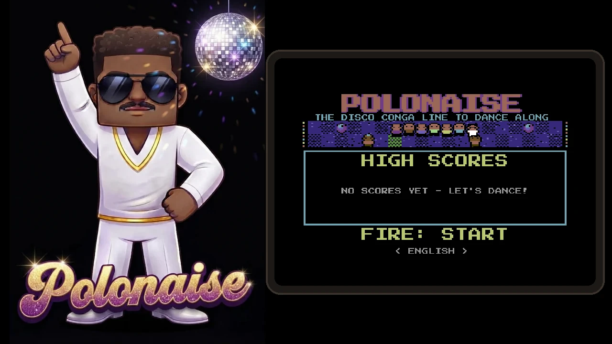
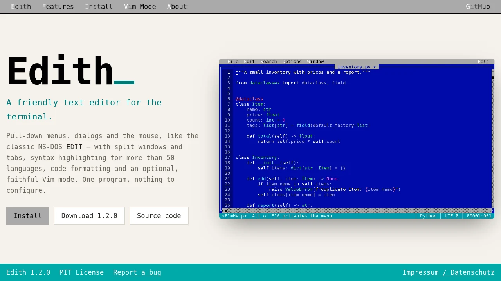
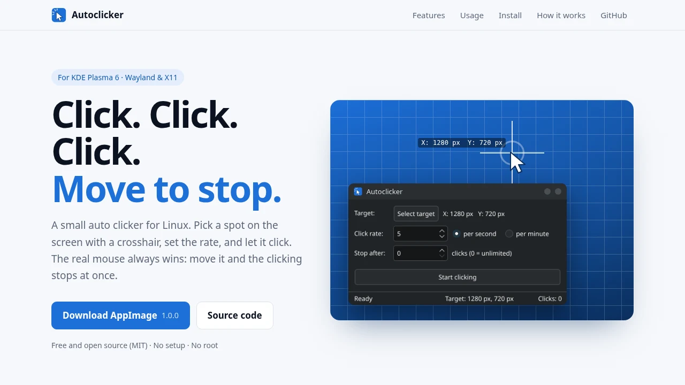
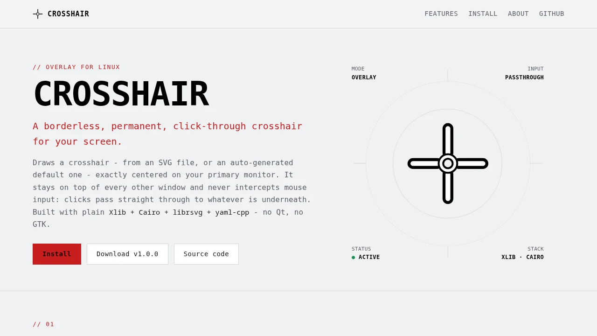
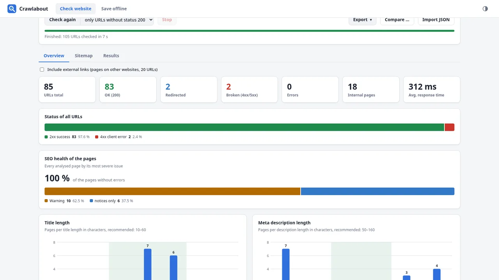
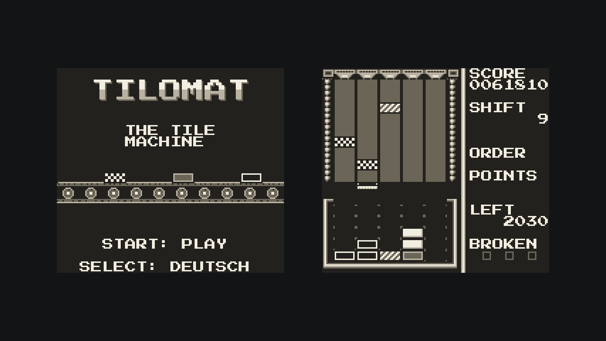

<table>
  <tr>
    <td width="50%" valign="top">
      
      
<b><a href="https://github.com/dlehmann/polonaise">Polonaise for the C64</a></b> 
      A disco conga line, steered like Snake – as a real Commodore 64 game on a D64 disk, with SID music and joystick control.

    </td>
    <td width="50%" valign="top">
      <a href="https://dlehmann.github.io/edith/">
        <picture>
          <source media="(prefers-color-scheme: dark)" srcset="images/edith-dark.webp">
          
        </picture>
      </a>
      
<b><a href="https://github.com/dlehmann/edith">Edith</a></b> 
      A friendly text editor for the terminal, with menus, mouse, split windows and an optional Vim mode.

    </td>
  </tr>
  <tr>
    <td width="50%" valign="top">
      <a href="https://dlehmann.github.io/autoclicker/">
        <picture>
          <source media="(prefers-color-scheme: dark)" srcset="images/autoclicker-dark.webp">
          
        </picture>
      </a>
      
<b><a href="https://github.com/dlehmann/autoclicker">Autoclicker</a></b> 
      Small auto clicker for KDE Plasma 6 – stops the moment you move the mouse.

    </td>
    <td width="50%" valign="top">
      <a href="https://dlehmann.github.io/crosshair/">
        <picture>
          <source media="(prefers-color-scheme: dark)" srcset="images/crosshair-dark.webp">
          
        </picture>
      </a>
      
<b><a href="https://github.com/dlehmann/crosshair">Crosshair</a></b> 
      Click-through crosshair overlay for Linux desktops, with custom SVG support.

    </td>
  </tr>
  <tr>
    <td width="50%" valign="top">
      <a href="https://dlehmann.github.io/crawlabout/">
        <picture>
          <source media="(prefers-color-scheme: dark)" srcset="images/crawlabout-dark.webp">
          
        </picture>
      </a>
      
<b><a href="https://github.com/dlehmann/crawlabout">Crawlabout</a></b> 
      Website exploration tool with a local web UI – finds broken links and SEO problems, shows the external services a site loads, searches its content, creates a sitemap.xml and detailed reports and saves websites for offline use.

    </td>
    <td width="50%" valign="top">
      
      
<b><a href="https://github.com/dlehmann/tilomat">Tilomat for the Game Boy</a></b> 
      The tile machine – catch tiles from the belt and line up three of a kind. A puzzle game for the original Game Boy, playable in the browser.

    </td>
  </tr>
</table>

---

[Impressum & Datenschutz](https://dlehmann.github.io/impressum)
