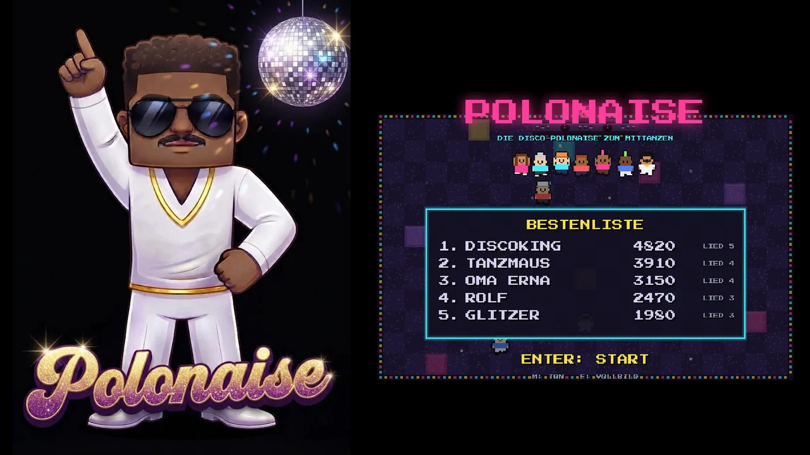
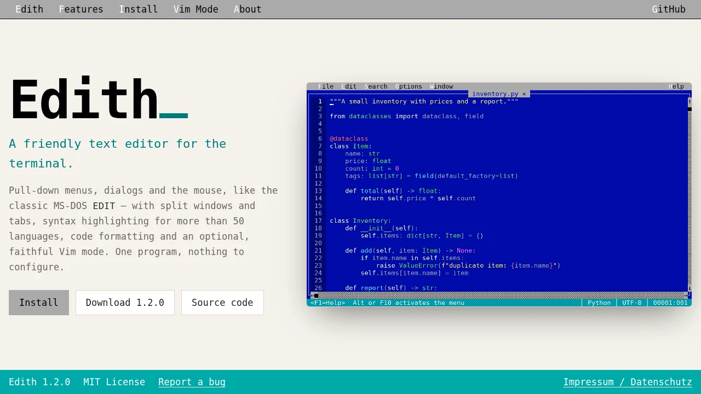
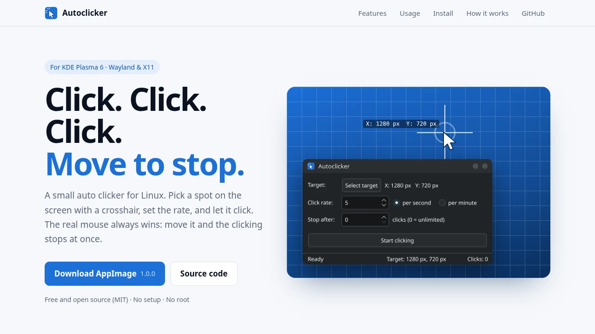

<table>
  <tr>
    <td width="50%" valign="top">
      
      
<b><a href="https://github.com/dlehmann/polonaise">Polonaise</a></b> 
      A disco conga line in pixel art, steered like Snake.

    </td>
    <td width="50%" valign="top">
      <a href="https://dlehmann.github.io/edith/">
        <picture>
          <source media="(prefers-color-scheme: dark)" srcset="images/edith-dark.webp">
          
        </picture>
      </a>
      
<b><a href="https://github.com/dlehmann/edith">Edith</a></b> 
      A friendly text editor for the terminal, with menus, mouse, split windows and an optional Vim mode.

    </td>
  </tr>
  <tr>
    <td width="50%" valign="top">
      <a href="https://dlehmann.github.io/autoclicker/">
        <picture>
          <source media="(prefers-color-scheme: dark)" srcset="images/autoclicker-dark.webp">
          
        </picture>
      </a>
      
<b><a href="https://github.com/dlehmann/autoclicker">Autoclicker</a></b> 
      Small auto clicker for KDE Plasma 6 – stops the moment you move the mouse.

    </td>
    <td width="50%" valign="top">
      <a href="https://dlehmann.github.io/crosshair/">
        <picture>
          <source media="(prefers-color-scheme: dark)" srcset="images/crosshair-dark.webp">
          
        </picture>
      </a>
      
<b><a href="https://github.com/dlehmann/crosshair">Crosshair</a></b> 
      Click-through crosshair overlay for Linux desktops, with custom SVG support.

    </td>
  </tr>
</table>

---

[Impressum & Datenschutz](https://dlehmann.github.io/impressum)
